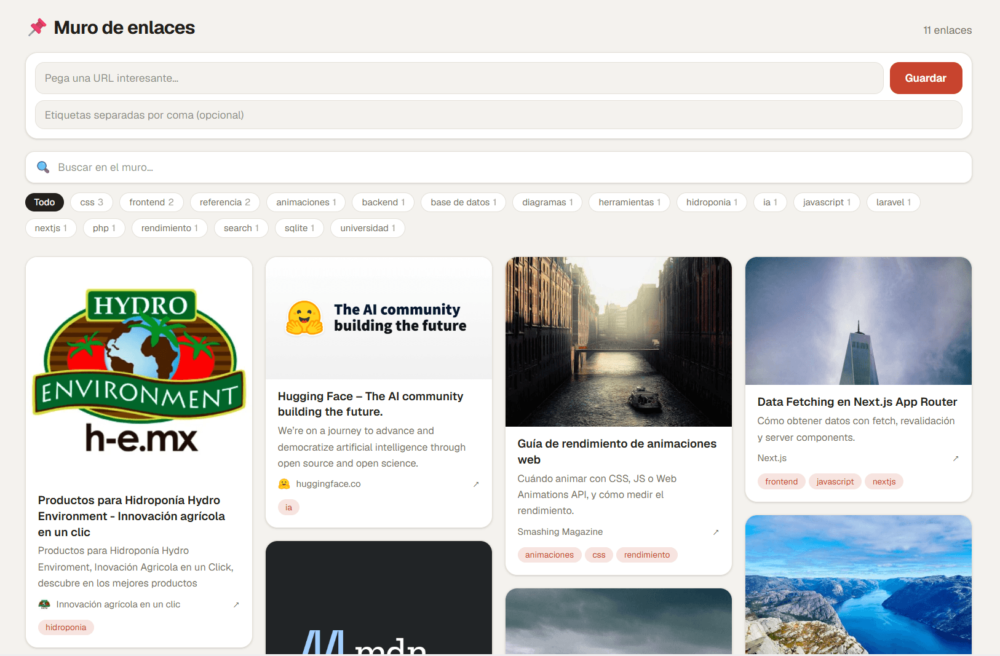

# Wallmark

**Un muro de enlaces para guardar y descubrir URLs interesantes.**

Pegas una URL, Wallmark extrae automáticamente su título, descripción, imagen y favicon, y la coloca en un muro con estilo masonry. Organiza todo con etiquetas, busca por texto y filtra por etiqueta.



## Stack

| Aplicación | Tecnología |
|---|---|
| `backend/` — API REST y panel de administración | Laravel 13 · PHP 8.4 · Blade + Vite + Tailwind CSS 4 · SQLite |
| `frontend/` — muro público | Next.js 16 (App Router) · React 19 · TypeScript · Tailwind CSS 4 |

> React y Next.js **no son dos frameworks distintos**: Next.js es el framework sobre el que corre el frontend React. Este repositorio contiene **dos aplicaciones**, no tres.

## Arquitectura

```
  navegador ──────► ┌──────────────────────────────────────┐
                    │ frontend/  Next.js  ·  :3000         │
                    │  muro · búsqueda · filtros · guardado │
                    └────────────────┬─────────────────────┘
                                     │  fetch (JSON)
                                     ▼
                    ┌──────────────────────────────────────┐
                    │ backend/  Laravel  ·  :8000          │
                    │  /api/v1 → API REST (links, tags)    │
                    │  /admin  → panel de administración   │
                    └────────────────┬─────────────────────┘
                                     ▼
                                  SQLite
```

El admin es una aplicación Blade servida por Laravel. El muro público es una aplicación Next.js que consume la API.

## Estructura del repositorio

```
wallmark/
├── backend/     Laravel: API REST + panel admin
├── frontend/    Next.js: muro público
└── .gitignore
```

## Requisitos

- PHP **8.4+** con las extensiones `curl`, `dom`, `fileinfo`, `mbstring`, `pdo_sqlite`, `xml`
- Composer 2
- Node.js **>= 20.9** (requisito de Next.js 16) y npm
- Git

## Puesta en marcha

### 1 · Backend (API + admin)

```bash
cd backend
composer run setup        # instala, configura, migra y siembra los datos de ejemplo
composer run dev          # → http://127.0.0.1:8000
```

`composer run setup` equivale a estos pasos manuales, si prefieres controlarlos uno a uno:

```bash
composer install
copy .env.example .env                         # macOS/Linux: cp .env.example .env
php artisan key:generate
type nul > database\database.sqlite           # macOS/Linux: touch database/database.sqlite
php artisan migrate --seed
npm install && npm run build                  # assets del panel admin
```

> `database/*.sqlite*` está ignorado en git, así que en un clon nuevo hay que **crear el archivo antes de migrar**. Por eso ese paso vive dentro de `composer run setup`.

### 2 · Frontend (muro público)

```bash
cd frontend
npm install
npm run dev                                    # → http://localhost:3000
```

Abre **http://localhost:3000** con el backend corriendo. Los 6 enlaces de ejemplo los crea el seeder.

## Panel de administración

- **http://127.0.0.1:8000/admin** (`/` redirige a `/admin`)
- Credenciales por defecto, configurables en `backend/.env`:

| Variable | Valor por defecto |
|---|---|
| `ADMIN_EMAIL` | `admin@wall.test` |
| `ADMIN_PASSWORD` | `password` |

## API

Prefijo `/api/v1`:

| Método | Ruta | Descripción |
|---|---|---|
| GET | `/links?q=&tag=&per_page=&page=` | Listado paginado con búsqueda y filtro por etiqueta |
| POST | `/links` | Guarda una URL y extrae su metadata (30 req/min) |
| PATCH | `/links/{id}` | Actualiza título, descripción o etiquetas |
| DELETE | `/links/{id}` | Elimina un enlace |
| GET | `/tags?q=` | Etiquetas ordenadas por uso (máx. 20) |

Documentación completa en [`backend/README.md`](backend/README.md).

## Variables de entorno

**`backend/.env`** — plantilla en `backend/.env.example`:

| Variable | Descripción |
|---|---|
| `APP_URL` | URL base del backend |
| `ADMIN_EMAIL` / `ADMIN_PASSWORD` | Credenciales del panel (las crea el seeder) |
| `DB_CONNECTION` | `sqlite` por defecto |

**`frontend/.env.local`**:

| Variable | Descripción | Valor por defecto |
|---|---|---|
| `NEXT_PUBLIC_API_URL` | Base de la API | `http://127.0.0.1:8000/api/v1` |

## Tests y calidad de código

```bash
cd backend
composer run test          # PHPUnit
vendor/bin/pint            # formato PHP

cd ../frontend
npm run lint               # ESLint
npm run build              # build de producción
```

## Despliegue

- **`backend/`** → [Laravel Cloud](https://cloud.laravel.com/) o cualquier hosting PHP
- **`frontend/`** → Vercel u otro hosting Node. En monorepo, configura el *root directory* en `frontend/` y define `NEXT_PUBLIC_API_URL` apuntando a la API ya desplegada.
